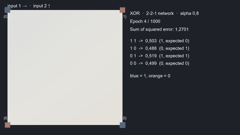

# Yapay Sinir Ağları: XOR'u öğrenen ağ (Unity 6.3)

BLM5026 Bilgisayar Oyunlarında Yapay Zeka · Rapor 8 (Hafta 9) · Veysel Uğurlu
Bursa Teknik Üniversitesi, Bilgisayar Mühendisliği Yüksek Lisans · Doç. Dr. İzzet Fatih Şentürk



Tek bir perceptron XOR'u öğrenemez. Bu projede perceptron'lar katmanlar halinde bağlanarak sıfırdan bir sinir ağı yazıldı (Neuron, Layer, ANN, Brain) ve hata geri yayılımı ile XOR'u öğretildi. Öğrenme oranı, aktivasyon fonksiyonu, nöron ve katman sayısının etkisi 50'şer başlangıçla ölçüldü.

| Deney (50 seed, 1000 epoch) | XOR'u öğrenen |
|---|---|
| Ders ayarları (2-2-1, sigmoid, alpha 0.8) | 14 / 50 |
| alpha 0.1 / step fonksiyonu / doğrusal fonksiyon | 0 / 50 |
| Gizli katmanda tanh | 27 / 50 |
| 4 gizli nöron | 46 / 50 |

Ayrıntılı açıklama, kod ve bütün deneyler: [docs/week09/README.md](docs/week09/README.md)

## Çalıştırma

1. Unity Hub → Add project from disk → bu klasör (Unity 6000.3.x).
2. `Assets/ANN2026/Scenes/Brain.unity` → Play: sonuçlar Console'da.
3. `Assets/ANN2026/Scenes/Visualizer.unity` → Play: ağın öğrenişi ekranda.

## Proje yapısı

```
Assets/ANN2026/Scripts/   Neuron, Layer, ANN, Brain, XorVisualizer
Assets/ANN2026/Scenes/    Brain.unity, Visualizer.unity
Assets/ANN2026/Editor/    sahne kurucu, deneyler, rapor görüntüleri (menü: ANN)
docs/week09/              rapor sayfası, grafikler, deney verisi
tools/                    grafik ve animasyon scriptleri (Python)
```

Her hafta ayrı bir `feature/...` dalında geliştirilir ve Pull Request ile `main` dalına birleştirilir.
