# Rapor 8 (Hafta 9): Yapay Sinir Ağları

BLM5026 Bilgisayar Oyunlarında Yapay Zeka · Veysel Uğurlu · Unity 6.3 LTS (6000.3.25f1) · Universal 3D

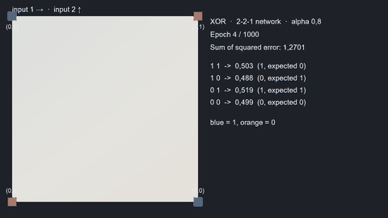

*2-2-1 sinir ağı XOR öğreniyor (seed 10, alpha 0.8). Her nokta, ağın o girdi için verdiği cevabın rengi: mavi 1, turuncu 0. İki gizli nöron iki çizgi çiziyor ve XOR'un 1 olduğu bölge bu iki çizginin arasında kalıyor.*

## 1. Bu hafta ne yapıldı?

Geçen hafta tek bir perceptron XOR işlemini öğrenemedi, çünkü XOR'un iki sınıfı tek bir doğruyla ayrılamıyor. Bu hafta birkaç perceptron katmanlar halinde bağlanarak bir yapay sinir ağı (YSA) kuruldu ve hata geri yayılımı (back propagation) ile eğitildi. Ağ sıfırdan, dersteki dört sınıfla (Neuron, Layer, ANN, Brain) yazıldı ve XOR'u öğrendi.

Ödevdeki her madde 50 farklı başlangıçla (seed) ölçüldü:

| Madde | Sonuç |
|---|---|
| XOR, alpha 0.8, 1000 epoch | 50 denemenin 14'ü öğrendi; öğrenenlerde SSE medyanı 0.0017. Kalan 36 deneme yerel minimumda kaldı (SSE ≈ 0.81) |
| alpha 0.1 | 1000 epoch'ta hiçbiri öğrenmedi; 10 000 epoch'ta 35/50 |
| Binary step fonksiyonu | hiçbir denemede öğrenme yok (0/50) |
| Büyük alpha | alpha 10, 30, 100'de 0/50; alpha 1000'de 50 denemenin hepsi NaN |
| XNOR | kod değişmeden 23/50 |
| Aktivasyon fonksiyonu | tanh 27/50; doğrusal fonksiyonla 0/50 |
| Nöron sayısı | 1 nöron 0/50, 2 nöron 14/50, 4 nöron 46/50 |

## 2. Temel kavramlar

| Kavram | Anlamı | Bu projede |
|---|---|---|
| Nöron | Bir perceptron: girdileri ağırlıklarla çarpar, bias ekler, aktivasyondan geçirir | `Neuron` |
| Katman | Aynı girdileri alan nöronlar | `Layer` |
| Girdi / gizli / çıktı katmanı | Veri girdi katmanından gizli katmanlara, oradan çıktıya akar | 2 girdi, 1 gizli katman (2 nöron), 1 çıktı |
| İleri yayılım | Her katmanın çıktısı bir sonraki katmanın girdisi olur | `ANN.Run` |
| Hata geri yayılımı | Çıktıdaki hata katman katman geriye dağıtılır, ağırlıklar güncellenir | `ANN.UpdateWeights` |
| errorGradient | Bir nöronun hataya katkısı (delta kuralı) | `çıktı · (1 − çıktı) · hata` |
| alpha | Öğrenme oranı: her güncellemede ağırlıkların ne kadar değişeceği | 0.8 |
| SSE | Hata kareleri toplamı: dört örnekteki (beklenen − bulunan)² toplamı | `sumSquareError` |
| Epoch | Eğitim kümesinin bir kez işlenmesi | 1000 |

## 3. Proje yapısı

```
Assets/ANN2026/
├── Scripts/   Neuron.cs, Layer.cs, ANN.cs, Brain.cs, XorVisualizer.cs
├── Scenes/    Brain.unity (boş nesne + Brain), Visualizer.unity
└── Editor/    sahne kurucu, deney koşucusu, rapor görüntüleri (menü: ANN)
tools/         grafik ve animasyon scriptleri (Python)
docs/week09/   bu sayfa, veriler, grafikler
```

`Neuron`, `Layer` ve `ANN` ders kodunun aynısı. İki ek yapıldı: aktivasyon fonksiyonu seçilebiliyor (varsayılan sigmoid, ders koduyla aynı sonucu verir) ve `Run` metoduna, ağın öğrenmeden yalnızca cevap vermesini sağlayan bir parametre eklendi. `Brain` ayarlarını Inspector'dan alıyor: kapı (XOR / XNOR), gizli katman ve nöron sayısı, aktivasyon, alpha, epoch ve seed.

### Unity Editor'dan görüntüler

| | |
|---|---|
| 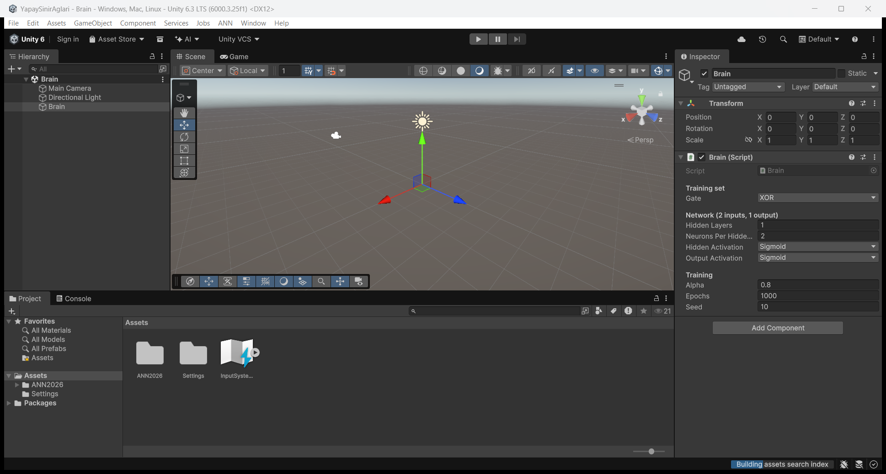 | 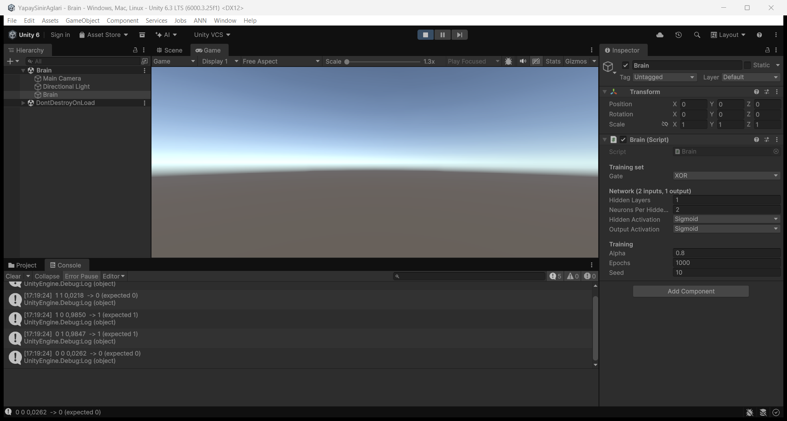 |
| *Brain nesnesi ve ayarları* | *Play: XOR sonuçları 0.02, 0.985, 0.985, 0.026* |
| 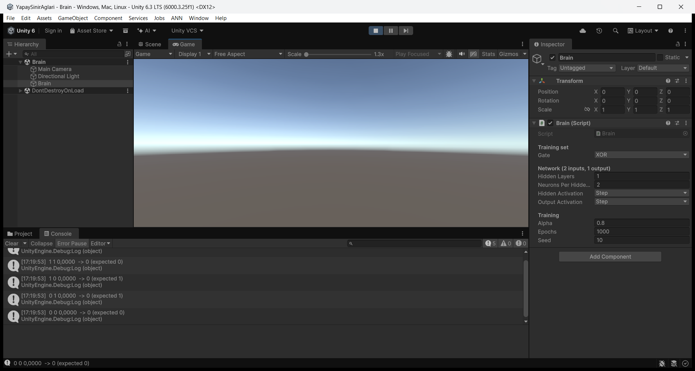 | 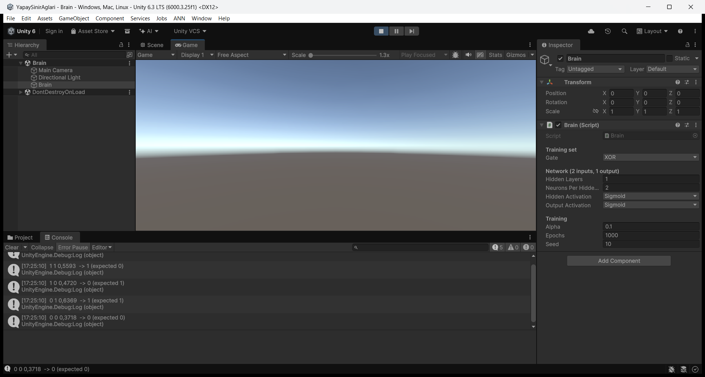 |
| *Step fonksiyonu: dört cevap da 0* | *alpha 0.1, 1000 epoch: eğitim bitmemiş* |
| 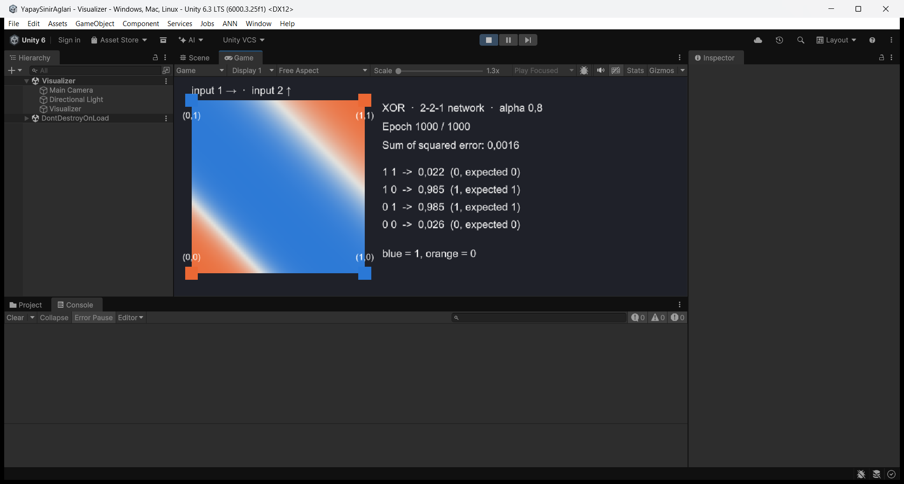 | |
| *Görselleştirici, 1000. epoch* | |

## 4. Ağın kodu

İleri yayılımda her nöron girdilerini ağırlıklarıyla çarpıp toplar, bias'ı çıkarır ve sigmoidden geçirir:

```csharp
N += layers[i].neurons[j].weights[k] * inputs[k];   // her girdi için
N -= layers[i].neurons[j].bias;
layers[i].neurons[j].output = ActivationFunction(N);
```

Geri yayılım çıktı katmanından başlar. Çıktı nöronunun errorGradient değeri hata ile sigmoidin eğiminin çarpımıdır. Gizli nöronun errorGradient değeri kendi eğimi ile bir sonraki katmandaki errorGradient'lerin ağırlıklı toplamının çarpımıdır; hata böylece geriye taşınır:

```csharp
errorGradient = output * (1 - output) * error;                       // çıktı katmanı
errorGradient = output * (1 - output) * Σ next.errorGradient * next.weights[j];   // gizli katman
weights[k] += alpha * inputs[k] * errorGradient;                     // gizli katman
bias       += alpha * -1 * errorGradient;
```

Ders kodunda çıktı katmanının ağırlıkları `errorGradient` yerine doğrudan `error` ile güncelleniyor. Kod bu haliyle korundu.

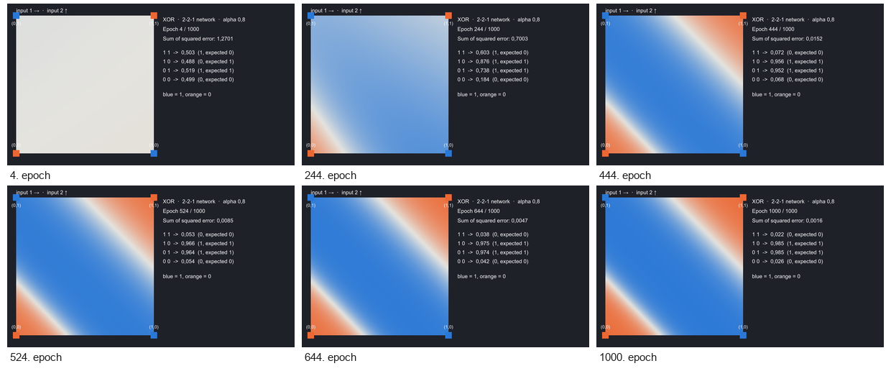

## 5. Deneyler

Her koşul 50 seed ile çalıştırıldı (seed 1-50); aynı seed aynı başlangıç ağırlıklarını verir. Bir deneme, dört çıktının yuvarlanmış hali eğitim kümesiyle aynıysa "öğrendi" sayıldı. Deneyler aynı `ANN` ve `Brain.TrainEpoch` koduyla, Unity editöründe çalıştırıldı ([AnnExperiments.cs](../../Assets/ANN2026/Editor/AnnExperiments.cs)). Bütün deneyler iki kez çalıştırıldı ve sonuç dosyası birebir aynı çıktı. Ham veri: [data/runs.csv](data/runs.csv), [data/curves.csv](data/curves.csv), özet: [data/summary.json](data/summary.json).

### 5.1 XOR ve yerel minimum

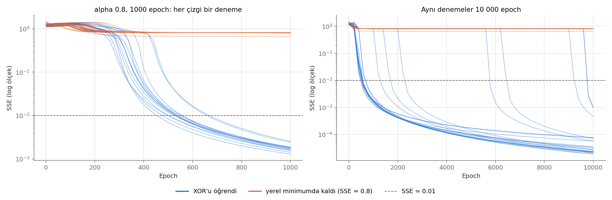

Ders ayarlarıyla (alpha 0.8, 1000 epoch) 50 denemenin 14'ü XOR'u öğrendi. Bu denemelerde SSE 0.001 düzeyine indi ve çıktılar 0 ile 1'e çok yakın oldu (ör. 0.022, 0.985, 0.985, 0.026). Kalan 36 denemenin hepsi aynı yerde takıldı: (1, 1) girdisine 0 yerine yaklaşık 0.64 cevap veriyor ve SSE 0.81 civarında sabit kalıyor. Ağ, VEYA'ya benzeyen bir çözüme yerleşmiş durumda; bu nokta bir yerel minimumdur. Eğitim 10 000 epoch'a uzatıldığında bu denemelerden 8'i daha kurtuldu (22/50). Bu yüzden sahnedeki Brain'e seed alanı eklendi: seed 0 her Play'de farklı başlangıç, seed 10 her seferinde öğrenen aynı deneme.

### 5.2 Öğrenme oranı (alpha)

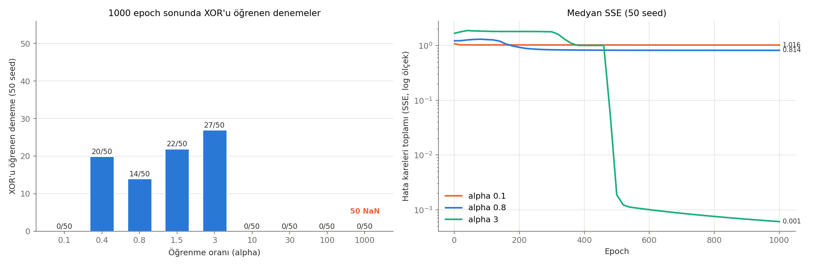

| alpha | 0.1 | 0.4 | 0.8 | 1.5 | 3 | 10 | 30 | 100 | 1000 |
|---|---|---|---|---|---|---|---|---|---|
| Öğrenen deneme | 0 | 20 | 14 | 22 | 27 | 0 | 0 | 0 | 0 (50 NaN) |

- alpha 0.1: ağırlıklar çok yavaş değişiyor; 1000 epoch sonunda SSE medyanı 1.02. Eğitim 10 000 epoch'a uzatıldığında 35/50 deneme öğrendi (ortalama 5049. epoch'ta).
- alpha 10-100: ağırlıklar ilk birkaç adımda çok büyüyor ve nöronlar sigmoidin düz bölgesine düşüyor (çıktı tam 0 ya da tam 1). Orada eğim sıfıra yakın olduğu için hata geriye taşınamıyor; ağ iki girdiyi doğru, ikisini yanlış bırakıp duruyor (SSE = 2). Bu, ders notlarında anlatılan kaybolan gradyan (vanishing gradient) sorunudur.
- alpha 1000: ağırlıklar o kadar büyüyor ki `Math.Exp` sonsuz değer döndürüyor ve sigmoid ∞/∞ = NaN hesaplıyor. 50 denemenin hepsinde çıktı NaN oldu.

### 5.3 Aktivasyon fonksiyonu

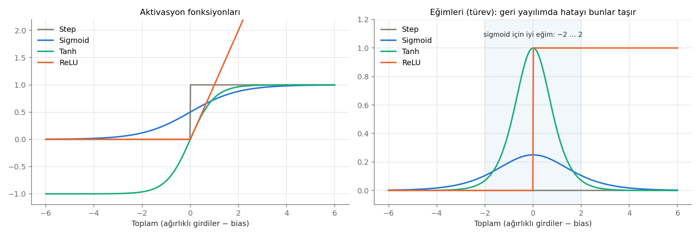

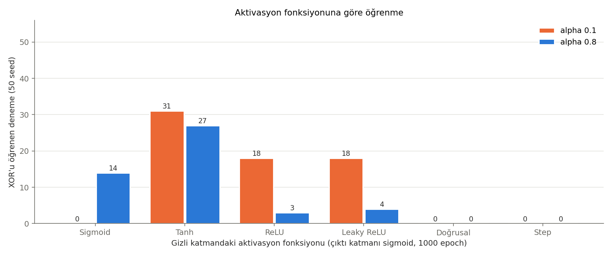

| Gizli katman aktivasyonu | alpha 0.1 | alpha 0.8 |
|---|---|---|
| Sigmoid | 0 | 14 |
| Tanh | 31 | 27 |
| ReLU | 18 | 3 |
| Leaky ReLU | 18 | 4 |
| Doğrusal | 0 | 0 |
| Step | 0 | 0 |

*Çıktı katmanı her durumda sigmoid. Ayrıca bütün katmanlar step yapıldığında da 0/50.*

- Step: eğimi her yerde 0. Gizli nöronların errorGradient değeri hep 0 olduğu için gizli katman hiç öğrenmiyor; epoch sayısı artırılsa da değişmez.
- Tanh: −1 ile 1 arasında çıktı veriyor ve sıfır çevresinde eğimi sigmoidin dört katı. İki alpha değerinde de en çok öğrenen fonksiyon oldu.
- ReLU ve Leaky ReLU: küçük alpha ile iyi, büyük alpha ile kötü. ReLU'nun çıktısı sınırsız olduğundan alpha 0.8'de ağırlıklar hızla büyüyor ve sıfırın altına düşen nöronlar bir daha güncellenmiyor.
- Doğrusal: hiçbir denemede öğrenmedi. Doğrusal fonksiyonlar art arda bağlandığında sonuç yine doğrusal bir fonksiyondur; ağ tek katmanlıymış gibi davranır ve XOR'u ayıramaz.

### 5.4 Katman ve nöron sayısı

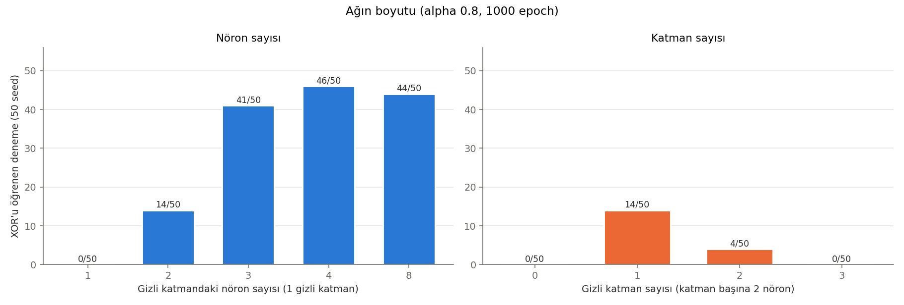

| Gizli nöron (1 katman) | 1 | 2 | 3 | 4 | 8 |
|---|---|---|---|---|---|
| Öğrenen deneme | 0 | 14 | 41 | 46 | 44 |

| Gizli katman (2 nöron) | 0 | 1 | 2 | 3 |
|---|---|---|---|---|
| Öğrenen deneme | 0 | 14 | 4 | 0 |

- Gizli katman yoksa ağ tek bir perceptrondur ve XOR'u öğrenemez (0/50).
- Tek gizli nöron da yetmiyor: XOR için iki çizgi gerekiyor, bir nöron yalnızca bir çizgi çizebilir.
- Nöron sayısı arttıkça ağ yerel minimuma daha az takılıyor: 3 nöronda 41/50, 4 nöronda 46/50. 8 nöronda (44/50) ek bir kazanç yok.
- Katman eklemek bu problemde işe yaramadı: 2 katmanda 4/50, 3 katmanda 0/50. Hata her katmanda sigmoidin eğimiyle (en fazla 0.25) çarpıldığı için ilk katmanlara çok küçülerek ulaşıyor.

### 5.5 XNOR

Eğitim kümesindeki çıktılar ters çevrildi; kodda hiçbir şey değişmedi. 50 denemenin 23'ü öğrendi, öğrenenlerde SSE medyanı 0.002.

## 6. Kısa sorular

1. Step fonksiyonu neden kullanılmamalı? Eğimi her yerde 0 olduğu için hata geriye taşınamaz; deneyde 0/50.
2. Sigmoid hangi aralıkta iyi öğrenir? Eğimi −2 ile 2 arasında yüksek, bunun dışında sıfıra yaklaşıyor (kaybolan gradyan).
3. Neden doğrusal olmayan fonksiyon gerekir? Doğrusal katmanlar üst üste konduğunda tek bir doğrusal katmana eşittir; deneyde doğrusal gizli katman 0/50.
4. Az ya da çok nöron kullanılırsa ne olur? 1 nöron problemi çözemedi. 2 nöron çoğu zaman yerel minimumda kaldı. 3-4 nöron en iyi sonucu verdi. 8 nöron daha iyi bir sonuç vermedi ve her epoch'ta daha fazla hesap yaptı.

## 7. Çalıştırma

1. Unity Hub → Add project from disk → depo klasörü (Unity 6000.3.x).
2. `Assets/ANN2026/Scenes/Brain.unity` → Play. Sonuçlar Console'da. Ayarlar Brain nesnesinin Inspector'ında.
3. `Assets/ANN2026/Scenes/Visualizer.unity` → Play: ağın öğrenişi ekranda.
4. Deneyler: ANN → Run Experiments, ardından `python tools/plot_experiments.py`.

| Ortam | Sürüm |
|---|---|
| Unity | 6000.3.25f1 (Unity 6.3 LTS), Universal 3D şablonu, URP 17.3.0 |
| Grafikler | Python 3.11, matplotlib, numpy, Pillow |

## 8. Kaynaklar

- Ders sunusu: *Bilgisayar Oyunlarında Yapay Zeka, Hafta 5: Artificial Neural Networks (ANNs)*, BLM5026, 2026.
- D. E. Rumelhart, G. E. Hinton, R. J. Williams, "Learning representations by back-propagating errors", *Nature*, 323, 533-536, 1986.
- I. Goodfellow, Y. Bengio, A. Courville, *Deep Learning*, MIT Press, 2016.
- I. Millington, *AI for Games*, 3. baskı, CRC Press, 2019.
- Wikipedia: "Delta rule", "Activation function".
